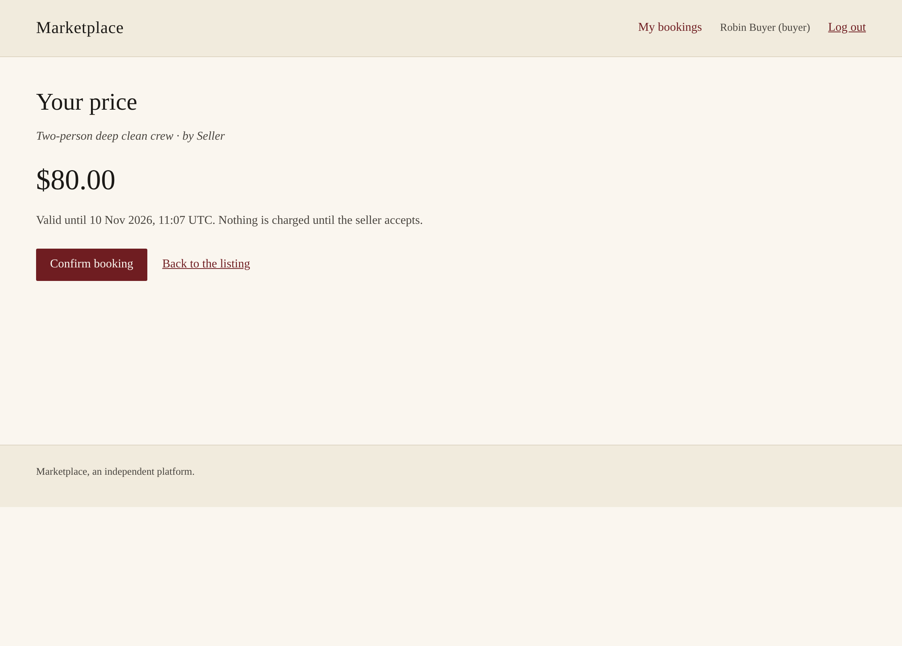
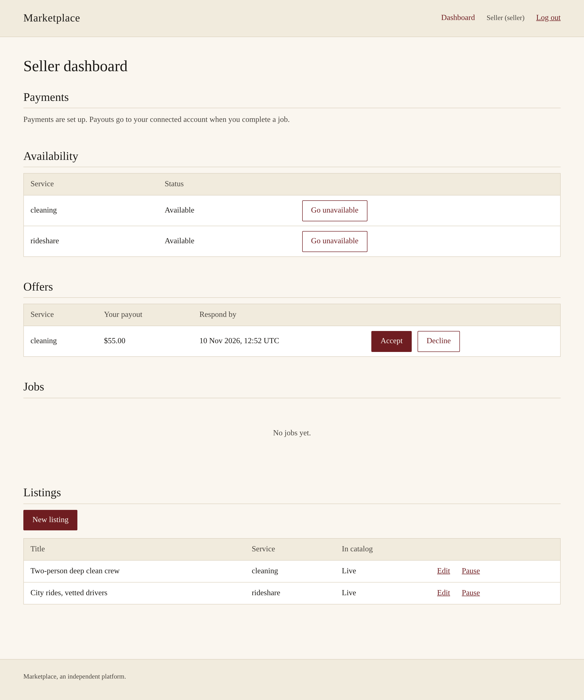

# marketplace

A two-sided marketplace backend in FastAPI where the platform sets **both
prices**: the buyer's price and the seller's payout come from two independent
pricing pipelines, and the platform keeps the difference. It is a template:
the seed and demo data use `rideshare` and `cleaning` as placeholder service
types, and nothing in the code is tied to a vertical.

What is distinctive about it:

- **Two independently computed prices, one spread.** Most marketplace kits
  assume a seller-set price plus a commission. Here a buyer-side adjuster
  pipeline produces the buyer price, a seller-side pipeline produces the
  payout, and a margin floor (checked net of estimated payment fees) keeps
  the spread from going negative. Adjusters and matching strategies are
  pluggable and tuned at runtime through admin endpoints.
- **Information asymmetry enforced by types.** Buyers never see the payout,
  sellers never see the buyer price, and the public catalog sees neither.
  Each audience has its own Pydantic response models, and tests scan
  responses, notification payloads and rendered HTML for the other side's
  fields.
- **Money-path discipline.** `Decimal` money, row locks for every status
  transition, commits that land before the response is sent, deterministic
  idempotency keys toward the payment provider, an append-only adjustments
  ledger for refunds and chargebacks, and webhook handling that is safe to
  replay twice or late.
- **Built agent-first, with the process left in the repo.** Almost all of
  the code was written by coding agents working from written specs and
  plans. The specs, plans, try-out findings, the invariants file the agents
  work under (`CLAUDE.md`), and the agent configuration (skills, reviewer
  subagents, hooks) are all checked in.

It is a working reference, not a production deployment. The default payment
provider is an in-memory fake; the Stripe adapter exists but has not been
run against live money from this repo. Known weaknesses are listed in
[`ROADMAP.md`](ROADMAP.md#known-limitations) and
[`SECURITY.md`](SECURITY.md).

**Stack:** Python 3.12+, FastAPI, Pydantic v2, SQLAlchemy 2.0 + Alembic,
Postgres 16 (SQLite for local work and tests), Jinja2 for the server-rendered
pages, argon2 password hashing via `pwdlib`, `uv` for dependencies, pyright in
strict mode.

## Contents

- [Quickstart](#quickstart)
- [Try it in ten minutes](#try-it-in-ten-minutes)
- [How it works](#how-it-works)
  - [Dispatch: the platform picks the seller](#dispatch-the-platform-picks-the-seller)
  - [Browse: the buyer picks the seller](#browse-the-buyer-picks-the-seller)
  - [Server-rendered pages](#server-rendered-pages)
- [Repository layout](#repository-layout)
- [Reference](#reference)
  - [Auth](#auth)
  - [Endpoints](#endpoints)
  - [Job and offer state machine](#job-and-offer-state-machine)
  - [Payments and webhooks](#payments-and-webhooks)
  - [Notifications](#notifications)
  - [Disputes](#disputes)
  - [Moderation](#moderation)
  - [Pricing adjusters and matching strategies](#pricing-adjusters-and-matching-strategies)
  - [Observability and operations](#observability-and-operations)
  - [Scaling settings](#scaling-settings)
  - [Configuration](#configuration)
- [Tooling](#tooling)
- [How this was built](#how-this-was-built)
- [Out of scope](#out-of-scope)

## Quickstart

```bash
uv sync

# The gate: lint, format check, strict types, tests (SQLite, no Docker needed)
uv run ruff check . && uv run ruff format --check . && uv run pyright && uv run pytest

# The whole lifecycle, headless, in-process, printed step by step
uv run python scripts/demo.py

# The API and pages on http://localhost:8000 (SQLite file ./marketplace.db)
uv run uvicorn marketplace.api:app --reload
```

With [`just`](https://github.com/casey/just) installed, `just gate`, `just
demo`, `just seed` and `just serve` run the same commands.

Against Postgres:

```bash
cp .env.example .env          # DATABASE_URL points at the compose Postgres
docker compose up -d db
uv run alembic upgrade head   # Postgres needs migrations; SQLite dev creates tables itself
uv run uvicorn marketplace.api:app --reload
```

The test suite runs against whatever `DATABASE_URL` points at, so
`DATABASE_URL=postgresql+psycopg://… uv run pytest` runs the same suite on
Postgres, where the `FOR UPDATE` locks are real. A few race tests only run
there; on SQLite they are reported as skipped.

## Try it in ten minutes

The fastest tour is headless: `uv run python scripts/demo.py` creates a
throwaway SQLite database and walks 24 numbered steps in-process: configure a
service type, onboard a seller, quote, match, charge, complete, review, an
asynchronous charge settled by webhook, a dispute with a partial refund,
moderation, notification mutes, fees, the operator stats endpoint, and a
browse listing booked through a pinned quote.

To click through it yourself:

```bash
# 1. Start the server. The flag is only needed to post fake-provider webhooks.
ALLOW_UNSIGNED_WEBHOOKS=true uv run uvicorn marketplace.api:app --reload

# 2. In another terminal, from the same directory: seed two service types,
#    pipelines, an admin, a demo buyer and seller, and one listing per type.
uv run python scripts/seed.py
```

`seed.py` writes to the same database as the server (`./marketplace.db`
unless `DATABASE_URL` says otherwise). It creates the admin account with demo
credentials unless `ADMIN_EMAIL`/`ADMIN_PASSWORD` are set, prints the
credentials and a bearer token for each of the three roles, and is safe to
re-run for fresh tokens (sessions last `SESSION_TTL_HOURS`, default 72).

- **Browse without a token.** Open `http://localhost:8000/` for the catalog
  pages, or `curl localhost:8000/v1/catalog/listings` for the same data as
  JSON. Sign up at `/signup` and the page header shows your display name;
  the session is held in an `HttpOnly` cookie.
- **Drive a job through Swagger** at `http://localhost:8000/docs`. Click
  **Authorize** and paste a token (the token only, no `Bearer ` prefix).
  1. As the **buyer**: `POST /v1/quotes` with `{"service_type_id":
     "rideshare"}` (the platform picks the seller) or `{"listing_id": "…"}`
     with an id from the catalog (pinned to that listing's seller), then
     `POST /v1/jobs` with `{"quote_id": "…"}`.
  2. As the **seller**: `GET /v1/seller/offers`, then
     `POST /v1/seller/offers/{id}/accept` (the fake provider charges
     immediately), then `POST /v1/seller/jobs/{id}/complete`.
  3. As the **admin**: `GET /v1/admin/margins/summary` for gross margin,
     adjustments and `platform_margin_net_of_fees`, and `GET
     /v1/admin/stats` for the operator snapshot.

  Compare the buyer's `GET /v1/jobs/{id}` (has `buyer_price`, no payout)
  with the seller's offer (has `seller_payout`, no buyer price).
- **Post a fake webhook** (only with `ALLOW_UNSIGNED_WEBHOOKS=true`):
  `curl -X POST localhost:8000/v1/payments/webhook -d
  '{"event_id":"evt_1","kind":"payment_succeeded","object_id":"pi_x"}'`
  answers `{"status":"ok"}` the first time and `{"status":"duplicate"}` the
  second; `GET /v1/admin/webhooks` shows the stored row. Without the flag
  and without a Stripe key, the route answers 404.

No payment account is needed for any of this. Cancelling a job, filing a
dispute, muting a notification kind and suspending a user all work the same
way through Swagger.

## How it works

### Dispatch: the platform picks the seller

1. A seller posts availability for a service type and has a **capacity**:
   how many jobs they can hold at once.
2. A buyer requests a quote. The platform runs the buyer-side adjuster
   pipeline over the service type's base price and probes the seller-side
   payouts. If the implied margin would fall below the configured floor plus
   the estimated provider fee, the buyer price is raised, or the quote is
   rejected if the raise would pass a ceiling.
3. The buyer creates a job from the quote (quotes are single-use). The
   matching strategy picks an eligible seller (payments onboarded, spare
   capacity, clears the floor, not suspended) and sends them an **offer**.
   If none fits, the job comes back `expired`.
4. The seller accepts or declines. On accept the buyer is charged and the
   seller's capacity is checked under a row lock. On decline or offer
   timeout the job is offered to the next candidate.
5. The seller completes the job. The payout is transferred, a transaction is
   booked with `margin = buyer_price − seller_payout`, and either side can
   review the other.

### Browse: the buyer picks the seller

Sellers can publish **listings**: a title, a description, up to 12 `https://`
photo URLs and one service type. A listing never carries a price; the
platform still prices both sides.

- **Visibility** needs both the seller's own `active` flag and the admin's
  `hidden` flag to allow it; the two are owned by different roles and never
  touch each other.
- **The public catalog** (`/v1/catalog/*`, no authentication) returns
  listings with a `price_from` (the buyer pipeline evaluated live, before
  the floor, so a real quote can come out higher) and a seller summary
  (display name, rating). It never returns a payout, capacity, email or
  payments status.
- **Pinned booking.** `POST /v1/quotes` with a `listing_id` pins the quote,
  and the job created from it, to that listing's seller. A pinned job is
  only ever offered to that seller: if they decline or the offer times out,
  the job expires instead of moving to a competitor. An unavailable listing
  fails with 409 at quote time and 410 at job time, and the quote is
  consumed either way.
- **Timeouts** default to `QUOTE_TTL_MINUTES=15` and `OFFER_TTL_MINUTES=120`,
  sized for a person browsing and a seller responding by hand.

Both modes share the job lifecycle, payments, disputes and notifications.

### Server-rendered pages

Jinja2 pages sit over the same catalog code and the same session table as the
JSON API, with no JavaScript build step:

| Route | Page |
|---|---|
| `GET /` | catalog landing, 24 listings per page, `?service_type_id=` and `?page=` |
| `GET /listings/{id}` | listing detail with photos and `price_from`; a logged-in buyer can ask for a price |
| `GET /sellers/{id}` | seller profile: rating, completed jobs, visible listings |
| `GET /quotes/{id}`, `GET /bookings`, `GET /bookings/{id}` | the buyer's exact price and its expiry, their bookings, and one booking's status as it moves, with cancel and the payment step |
| `GET /seller` | seller dashboard: offers to accept or decline, jobs to complete, listings, availability, payments onboarding |
| `GET/POST /signup`, `GET/POST /login`, `POST /logout` | cookie-backed account pages, buyer and seller only |
| `GET/POST /verify`, `/password-reset`, `/password-reset/confirm` | the pages the verification and reset emails link to |

A buyer can browse, get a price, book, pay and follow a booking, and a
seller can accept, complete and manage listings, without leaving the
browser. The pages call the same services as the JSON API, so every rule
there applies here: the buyer's pages show the buyer's price and never the
payout, and the seller's show the payout and never the price.

| The buyer sees | The seller sees |
|---|---|
|  |  |

More screenshots of the flow are in [`docs/screenshots/`](docs/screenshots/).

A successful page signup or login stores the session token in an `HttpOnly`,
`SameSite=Lax` cookie (`Secure` when `COOKIE_SECURE=true`). It is the same
`auth_sessions` row a bearer client gets, so logout and password reset revoke
it the same way. Every form under a session carries a CSRF token derived
from that session. There is no browser login for admins. Seller-supplied
text renders on public pages, so template autoescaping is treated as a
security boundary and tested; see `SECURITY.md`.

**Paying.** When a charge needs confirming in the browser, the booking page
mounts Stripe's Payment Element on the job's client secret
(`STRIPE_PUBLISHABLE_KEY`), and the webhook, not the browser redirect,
settles the booking. With the fake provider there is nothing to mount: the
page shows the pending state and updates when the development webhook lands.
The Stripe path is wired and unit-tested but has not been run against a live
Stripe account.

To see the whole flow locally with a payment that waits for confirmation:

```
uv run python scripts/seed.py
ALLOW_UNSIGNED_WEBHOOKS=true FAKE_CHARGES_PENDING=true uv run uvicorn marketplace.api:app
```

## Repository layout

```
src/marketplace/
  api.py                    app assembly only: middleware, lifespan, router mounting, error mapping
  routers/                  thin JSON routers: buyer, seller, admin, catalog, payments, reports, preferences
  services/                 domain logic: booking, jobs, offers, webhooks, disputes, payouts, maintenance, ...
  errors.py                 domain errors the services raise, mapped to HTTP in one place
  pricing.py, matching.py   the pure pricing and matching core (adjusters, strategies)
  config.py, repo.py        snapshots the core runs on, and the code that loads them
  catalog.py                the one implementation of catalog visibility and "from" prices
  auth.py                   signup/login, sessions, principal resolution (bearer header or cookie)
  pages/, templates/        server-rendered pages: storefront, account, buyer, seller, CSRF
  models.py                 Pydantic views, one family per audience: Buyer*, Seller*, Admin*, Catalog*
  entities.py               SQLAlchemy ORM
  db.py                     engine, pool sizing, CommitRoute (commit before the response is sent)
  payments/                 provider port, deterministic fake, Stripe adapter
  notifications.py, mail.py transactional outbox and the mail port
  idempotency.py            Idempotency-Key replay
  observability.py          request ids, JSON logs, error envelope, pool-exhaustion 503
  settings.py               every environment setting and its default
migrations/versions/        Alembic; runs from empty on SQLite and Postgres
tests/                      pytest; tests/test_architecture.py holds the invariants as checks
src/marketplace_mcp/        ops MCP server: the admin API as operator tools (HTTP client only)
scripts/                    demo.py (headless lifecycle), seed.py (demo data + tokens)
loadtest/                   Locust harness and staged runner
docs/                       deployment guide, agent setup, phase specs/plans, try-out findings
.claude/                    agent skills, reviewer subagents, hooks
evals/                      reviewer evaluation: real past bugs re-seeded as review cases
.semgrep/                   Semgrep rules for the security invariants, with a test corpus
```

A request goes router → service → (`repo`, `catalog`, `payments`,
`notifications`). Services import no web framework and raise domain errors;
routers and pages both call them. `tests/test_architecture.py` enforces the
layering.

## Reference

The rules every change has to keep (identity, asymmetry, money, commits,
webhooks, pagination and more) are in [`CLAUDE.md`](CLAUDE.md). This section
describes behavior, not those rules.

### Auth

Accounts are real users with argon2-hashed passwords. Signup or login returns
an opaque bearer token; only its sha256 is stored, in `auth_sessions`. Each
request resolves `(role, user_id)` from that row with one indexed lookup, and
identity is always taken from the session, never from a request body.
Sessions expire after `SESSION_TTL_HOURS` (default 72) and are revocable:
logout deletes the session, a password reset deletes every session for that
account.

```python
import httpx
r = httpx.post(f"{BASE}/v1/auth/signup", json={
    "email": "alice@example.com", "password": "correct-horse-battery",
    "role": "buyer", "display_name": "Alice",
})
headers = {"Authorization": f"Bearer {r.json()['token']}"}
```

- An **account is one email plus one role.** The same email can hold a
  separate buyer and seller account, each with its own password.
- **There is no admin signup.** The admin account is created at startup from
  `ADMIN_EMAIL`/`ADMIN_PASSWORD`; leave them unset and there is no admin.
  Changing `ADMIN_PASSWORD` and restarting replaces the hash and revokes
  existing admin sessions.
- **Bearer header first, cookie second.** Browser pages send the session in
  a cookie; if a request carries both, the `Authorization` header wins.
- **Mail** (verification and reset links) goes through an `EmailSender` port
  in `mail.py`. With `SMTP_HOST` set it sends over SMTP; otherwise it logs
  the message. The links point at `BASE_URL/verify?token=…` and
  `BASE_URL/password-reset/confirm?token=…`. The app serves both pages; each
  renders a form that POSTs the token, so opening a link never consumes it.
  A separate frontend can instead pass the token to `POST /v1/auth/verify`
  or `POST /v1/auth/password-reset/confirm`.
- **Email verification is optional.** `REQUIRE_VERIFIED_EMAIL` (default
  false) requires a verified email to create a job, accept an offer or
  create a listing, in the API and the pages alike. With it off,
  `email_verified` is recorded and nothing checks it.
- **No rate limiting** on login, signup or password reset. These run argon2
  and are the cheapest way to load the server; put a limit in front of them
  at the edge ([`docs/DEPLOY.md`](docs/DEPLOY.md#edge-rate-limits)).

### Endpoints

Generated from the running app's OpenAPI schema (`/openapi.json`, browsable
at `/docs`). "Status" is the success code: POSTs that create a resource
return 201, POSTs that act on an existing one return 200. List endpoints
marked "paged" take `limit` (1–200; default 50 on buyer, seller and catalog
lists, 100 on admin lists) and `offset`; several also take a `status` filter.

**Unauthenticated**

| Method | Path | Status | Notes |
|---|---|---|---|
| GET | `/healthz` | 200 | liveness; excluded from the access log |
| POST | `/v1/auth/signup` | 201 | returns a session token |
| POST | `/v1/auth/login` | 200 | returns a session token |
| POST | `/v1/auth/verify` | 200 | consume an email-verification token |
| POST | `/v1/auth/password-reset/request` | 200 | always `{"status": "ok"}` |
| POST | `/v1/auth/password-reset/confirm` | 200 | sets the password, revokes every session |
| GET | `/v1/catalog/listings` | 200 | paged; optional `service_type_id` |
| GET | `/v1/catalog/listings/{listing_id}` | 200 | one visible listing |
| GET | `/v1/catalog/sellers/{seller_id}` | 200 | public profile plus visible listings |
| POST | `/v1/payments/webhook` | 200 | provider events; signature-verified; see [Payments](#payments-and-webhooks) |
| GET | `/`, `/listings/{id}`, `/sellers/{id}` | 200 | HTML pages; render a signed-in header if a session cookie is present |
| GET/POST | `/signup`, `/login` | 200 / 303 | HTML forms; a successful POST sets the cookie and redirects |
| POST | `/logout` | 303 | clears the cookie, revokes the session if there is one |

**Any signed-in user**

| Method | Path | Status | Notes |
|---|---|---|---|
| POST | `/v1/auth/logout` | 200 | revokes this session |
| GET | `/v1/auth/me` | 200 | own account |
| GET | `/v1/notification-preferences` | 200 | own muted kinds, limited to kinds for the caller's role |
| PUT | `/v1/notification-preferences` | 200 | replace the muted set |
| POST | `/v1/reports` | 201 | buyer or seller: report a counterparty or a review |
| GET | `/v1/reports` | 200 | buyer or seller: own filed reports |

**Buyer** (buyer session)

| Method | Path | Status | Notes |
|---|---|---|---|
| POST | `/v1/quotes` | 201 | `{service_type_id}` for dispatch or `{listing_id}` for pinned |
| POST | `/v1/jobs` | 201 | `{quote_id}`; consumes the quote |
| GET | `/v1/jobs` | 200 | paged, `status` |
| GET | `/v1/jobs/{job_id}` | 200 | carries `client_secret` while the charge awaits confirmation |
| POST | `/v1/jobs/{job_id}/cancel` | 200 | voids or refunds the charge |
| POST | `/v1/jobs/{job_id}/review` | 201 | rate the seller |
| GET | `/v1/jobs/{job_id}/reviews` | 200 | this job's reviews, no party ids |
| POST | `/v1/jobs/{job_id}/dispute` | 201 | completed jobs, within `DISPUTE_WINDOW_DAYS` |
| GET | `/v1/jobs/{job_id}/dispute` | 200 | buyer view (no clawback amount) |
| GET | `/v1/profile` | 200 | own rating aggregate from seller reviews |

**Seller** (seller session)

| Method | Path | Status | Notes |
|---|---|---|---|
| GET, PUT | `/v1/seller/profile` | 200 | own profile and capacity |
| POST | `/v1/seller/payments/onboard` | 200 | create or refresh the provider account |
| POST | `/v1/seller/availability` | 200 | available for a service type |
| DELETE | `/v1/seller/availability/{service_type_id}` | 200 | withdraw |
| POST | `/v1/seller/listings` | 201 | title, description, photos, service type; never a price |
| GET | `/v1/seller/listings` | 200 | own listings in any state |
| PUT | `/v1/seller/listings/{listing_id}` | 200 | edit, or toggle `active` |
| GET | `/v1/seller/offers` | 200 | paged, `status`; shows `seller_payout`, never the buyer price |
| POST | `/v1/seller/offers/{offer_id}/accept` | 200 | charges the buyer |
| POST | `/v1/seller/offers/{offer_id}/decline` | 200 | re-matches (dispatch) or expires (pinned) |
| GET | `/v1/seller/jobs` | 200 | paged, `status` |
| POST | `/v1/seller/jobs/{job_id}/complete` | 200 | transfers the payout; returns a seller-scoped receipt |
| POST | `/v1/seller/jobs/{job_id}/review` | 201 | rate the buyer |
| GET | `/v1/seller/jobs/{job_id}/reviews` | 200 | this job's reviews, no party ids |
| GET | `/v1/seller/jobs/{job_id}/dispute` | 200 | seller view (no refund amount) |

**Admin** (admin session)

| Method | Path | Status | Notes |
|---|---|---|---|
| GET | `/v1/admin/config` | 200 | service types, pipelines, floor, strategy, params, fees |
| PUT | `/v1/admin/config/service_types/{service_type_id}` | 200 | base prices |
| PUT | `/v1/admin/config/pipelines/{service_type_id}` | 200 | buyer and seller adjuster lists |
| PUT | `/v1/admin/config/margin_floor` | 200 | |
| PUT | `/v1/admin/config/matching_strategy` | 200 | |
| PUT | `/v1/admin/config/adjuster_params/{adjuster_name}` | 200 | |
| PUT | `/v1/admin/config/fees` | 200 | `pct`/`fixed` provider-fee estimate |
| PUT | `/v1/admin/sellers/{seller_id}` | 200 | tier and capacity |
| GET | `/v1/admin/buyers` | 200 | paged; rating aggregates |
| GET | `/v1/admin/jobs` | 200 | paged, `status` |
| POST | `/v1/admin/jobs/{job_id}/cancel` | 200 | |
| POST | `/v1/admin/jobs/sweep` | 200 | run the expiry sweep and housekeeping now |
| GET | `/v1/admin/transactions` | 200 | paged; both prices and the margin |
| GET | `/v1/admin/margins/summary` | 200 | gross, net of adjustments, net of estimated fees |
| GET | `/v1/admin/payouts` | 200 | paged, `status` |
| POST | `/v1/admin/payouts/{payout_id}/retry` | 200 | |
| GET | `/v1/admin/disputes` | 200 | paged, `status` |
| POST | `/v1/admin/disputes/{dispute_id}/resolve` | 200 | independent refund and clawback amounts |
| GET | `/v1/admin/webhooks` | 200 | paged, `status`; the webhook outbox |
| POST | `/v1/admin/webhooks/{webhook_id}/retry` | 200 | re-queue a failed or dead-lettered event |
| GET | `/v1/admin/notifications` | 200 | paged, `status` |
| POST | `/v1/admin/notifications/drain` | 200 | send pending mail now |
| GET | `/v1/admin/listings` | 200 | paged; every listing in any state |
| POST | `/v1/admin/listings/{listing_id}/hide` | 200 | takedown |
| POST | `/v1/admin/listings/{listing_id}/unhide` | 200 | |
| GET | `/v1/admin/reviews/{kind}` | 200 | paged; `buyer` or `seller` reviews, raw comments |
| POST | `/v1/admin/reviews/{kind}/{review_id}/hide` | 200 | hide the comment, keep the rating |
| POST | `/v1/admin/reviews/{kind}/{review_id}/unhide` | 200 | |
| GET | `/v1/admin/reports` | 200 | paged, `status` |
| POST | `/v1/admin/reports/{report_id}/resolve` | 200 | terminal; takes no other action |
| POST | `/v1/admin/users/{user_id}/suspend` | 200 | |
| POST | `/v1/admin/users/{user_id}/reinstate` | 200 | |
| POST | `/v1/admin/users/{user_id}/reset_display_name` | 200 | sets `user-{id[:8]}` |
| GET | `/v1/admin/audit` | 200 | paged; admin action log |
| GET | `/v1/admin/stats` | 200 | operator snapshot |

Any POST except the page auth forms (`/signup`, `/login`, `/logout`) accepts
an `Idempotency-Key` header: the first response is stored
per authenticated principal and key and replayed byte for byte on a repeat.
401, 403 and 5xx responses are never stored, and the same key on a different
path is a 409.

### Job and offer state machine

- **Job**: `pending → awaiting_payment? → accepted → completed`, plus
  `expired` (no seller took it, a pinned seller declined or timed out, or
  the payment never arrived) and `cancelled`. A job only waits in
  `awaiting_payment` when the provider's charge doesn't clear inline, and it
  still holds the seller's capacity slot while it waits.
- **Offer**: `offered → accepted | declined | expired`. On a dispatch job,
  decline and expiry offer the job to the next eligible seller who has not
  had an offer for it. Offer expiry runs lazily on reads, on the maintenance
  loop, and on `POST /v1/admin/jobs/sweep`.

### Payments and webhooks

Payments work as escrow, not commission: accepting an offer charges the buyer
and the money lands on the platform's balance; completing the job transfers
`seller_payout` to the seller. The spread is what remains.

- **Providers sit behind a port** (`payments/port.py`). With
  `STRIPE_SECRET_KEY` unset the app uses a deterministic in-memory fake
  (charges succeed instantly unless scripted otherwise). With it set the app
  uses the Stripe Connect adapter (`payments/stripe_provider.py`). The
  adapter's tests cover webhook signature verification and event mapping;
  the project history records a manual run of the escrow loop against a
  Stripe test account, which this repo cannot re-verify automatically.
- **Asynchronous charges.** If a charge doesn't clear inline, the job waits
  in `awaiting_payment` and the buyer's job view carries `client_secret` for
  client-side confirmation. The provider's webhook moves the job to
  `accepted`. Charges not confirmed within `PAYMENT_TTL_MINUTES` (default 30)
  are released by the sweep.
- **Idempotency toward the provider.** Outbound requests carry keys derived
  from the job (`charge:{job_id}`, `transfer:{job_id}`, …), so a retry
  replays the original result instead of charging twice.
- **Webhook authenticity.** `POST /v1/payments/webhook` is unauthenticated;
  with Stripe configured, every event must pass signature verification
  (`STRIPE_WEBHOOK_SECRET`, and startup refuses a Stripe key without it).
  The fake provider can't sign anything, so in fake mode the route answers
  404 unless `ALLOW_UNSIGNED_WEBHOOKS=true`, which is for local
  development, tests and the demo only (startup refuses it alongside a
  Stripe key).
- **Webhook outbox.** Every event is recorded by its provider event id
  before it is applied, and any later delivery of the same id answers
  `{"status": "duplicate"}`. If applying an event fails, the row is stored
  as `failed` with the attempt count, a one-line error and a next-attempt
  time, and the endpoint answers 200 `{"status": "deferred"}`, so the
  provider doesn't keep redelivering. The maintenance loop retries due rows
  with exponential backoff (`WEBHOOK_RETRY_BASE_SECONDS` × 5^(attempts−1)),
  and after `WEBHOOK_MAX_ATTEMPTS` the row becomes `dead_letter` and every
  admin gets a notification that can't be muted. Operators list rows with
  `GET /v1/admin/webhooks` and re-queue one with
  `POST /v1/admin/webhooks/{id}/retry`. The stored payload is the parsed
  event fields, never the raw body or signature. Every event type is safe to
  apply twice and safe to apply after later events
  (`tests/test_webhook_replay.py`).
- **Client idempotency** is described under [Endpoints](#endpoints).

To use a real Stripe account, point its webhook at `POST /v1/payments/webhook`
and set `STRIPE_SECRET_KEY` and `STRIPE_WEBHOOK_SECRET`. The checklist before
doing that with live keys is in [`docs/DEPLOY.md`](docs/DEPLOY.md#before-enabling-real-payments).

### Notifications

Fifteen notification kinds email the right party: a new offer to the seller;
accepted, completed, expired and refund notices to the buyer; a cancel
notice to a committed seller; dispute opened and resolved notices; and
admin alerts for disputes, chargebacks, reports, failed payouts and
dead-lettered webhooks. Each user can mute kinds for their own role through
`GET/PUT /v1/notification-preferences`, except five that no path can mute:
`refund_issued_buyer`, `dispute_resolved_buyer`, `dispute_resolved_seller`,
`payout_failed_admin` and `webhook_dead_letter_admin`.

Delivery is a **transactional outbox**: a state change and its notification
row commit together, so a rolled-back accept emails no one. An in-process
maintenance loop sends pending rows every `NOTIFY_DRAIN_SECONDS` with retry
and backoff up to `NOTIFY_MAX_ATTEMPTS`, after which a row is `failed`
(inspect with `GET /v1/admin/notifications`, force a pass with
`POST /v1/admin/notifications/drain`). Payloads are snapshots taken at
enqueue time and respect the asymmetry: seller mail carries the payout and
never the buyer price, and the reverse for buyers. Set `SMTP_HOST` (plus port,
credentials and `MAIL_FROM`) for real mail; any SMTP endpoint works, Mailpit
locally. Verification and reset mail is the one exception to the outbox: it
carries a raw single-use token, so it is sent directly instead of being
stored.

### Disputes

A buyer can dispute a **completed** job within `DISPUTE_WINDOW_DAYS`
(default 7) of completion, once per job; problems before completion use
cancel. An admin resolves it with a `refund_amount` (0 to the buyer price, a
partial refund to the buyer) and a `clawback_amount` (0 to the payout, a
partial transfer reversal from the seller), set independently; 0/0 rejects
the dispute. Each resolution appends rows to an append-only `adjustments`
ledger; booked transactions are never edited, and a partial refund leaves the
charge's status `succeeded`.

`GET /v1/admin/margins/summary` reports gross margin, `platform_margin_net`
(after adjustments), `fees_estimated` (the sum of the fee estimate stamped on
each charge when it was made) and `platform_margin_net_of_fees`.

Provider chargebacks arrive through the same webhook into the same
`disputes` table. The platform records the outcome and notifies admins;
submitting evidence stays in the provider's dashboard. A lost chargeback
books a `chargeback_loss` adjustment plus a `chargeback_fee`
(`CHARGEBACK_FEE_USD`, default 15.00). An admin's resolution is kept as the
dispute's status even if a chargeback closes later; the loss and fee are
still booked.

The buyer's dispute view never carries the clawback amount, the seller's
never carries the refund amount; only the admin view has both.

### Moderation

- **Suspension** blocks a user's acquisition actions (quotes, jobs, reviews,
  disputes, availability, accepting offers, payment onboarding, filing
  reports) with a 403, and removes a suspended seller from matching. Login,
  reads, complete, decline and cancel keep working so in-flight work can
  finish. Suspension moves no money. Admins can't be suspended.
- **Takedown hides, it never deletes.** Hiding a review comment removes the
  text from non-admin views; the rating still counts. Admins can reset a
  display name to `user-{id[:8]}` and hide or unhide listings.
- **Reports** are limited to counterparties (someone you shared a job with,
  or a review you are a party to), one per reporter and target. Resolving a
  report is terminal and takes no automatic action.

### Pricing adjusters and matching strategies

Adjusters live in `pricing.py`; a new one is a function registered with
`@register("name")`. Pipelines (which adjusters run, per side and service
type) and their parameters are set through the admin config endpoints, with
no code change.

| Name | Side | Params |
|---|---|---|
| `surge_by_demand_ratio` | buyer | `max_multiplier`, `min_multiplier` |
| `time_of_day_multiplier` | both | `multipliers: {hour: float}` |
| `new_buyer_discount` | buyer | `discount_pct` |
| `supply_incentive` | seller | `max_bonus_pct` |
| `seller_tier_multiplier` | seller | `tiers: {tier: float}` |

Parameters are clamped when read, so an out-of-range value is bounded rather
than trusted.

Matching strategies live in `matching.py` (`@register_strategy("name")`):
`cheapest_payout` (default), `fifo` and `highest_rated`. Every strategy only
chooses among sellers that clear the net-of-fees margin floor and have spare
capacity. The pricing and matching core is pure: it works on snapshots and
never touches the database.

### Observability and operations

- **Request ids.** An inbound `X-Request-ID` is honored if it is well formed
  (otherwise replaced), echoed on the response, and attached to every log
  line for that request.
- **Logs** are JSON by default (`LOG_FORMAT=plain` for local reading). The
  access log records method, path without its query string, status,
  duration and request id, never headers or bodies.
- **Errors.** Any unhandled exception becomes
  `{"detail": "internal error", "request_id": …}` with status 500; the
  traceback goes to the log only. Connection-pool exhaustion becomes a 503
  with `Retry-After` instead (see [Scaling settings](#scaling-settings)).
- **`GET /v1/admin/stats`** returns job, payment, payout, notification,
  dispute, report, user and quote counts, retention-table sizes and uptime.
- **Retention.** The maintenance loop deletes `idempotency_keys` older than
  `RETENTION_IDEMPOTENCY_DAYS` (7), applied or dead-lettered
  `webhook_events` older than `RETENTION_WEBHOOKS_DAYS` (30), and sent or
  failed `notifications` older than `RETENTION_NOTIFICATIONS_DAYS` (30).
  Pending notifications and failed webhook events are never deleted,
  whatever their age.
- **Request limits.** Bodies over `MAX_BODY_BYTES` (1 MiB) get a 413.
  `TRUSTED_HOSTS` and `CORS_ORIGINS` are open by default for development and
  must be narrowed in production; both are JSON arrays
  (`TRUSTED_HOSTS='["api.example.com"]'`), not comma-separated strings.

### Scaling settings

- **Connection pool.** On Postgres the pool defaults to 10 connections plus
  30 overflow (`DB_POOL_SIZE`, `DB_MAX_OVERFLOW`), one per token in
  Starlette's default 40-thread pool, with a 5-second checkout timeout
  (`DB_POOL_TIMEOUT_SECONDS`). A request that can't get a connection in that
  time gets a 503 with `Retry-After: 1` rather than waiting, and the 503 is
  never stored for idempotent replay (`tests/test_capacity.py`).
  `DB_POOL=null` disables app-side pooling for deployments behind an
  external pooler. SQLite ignores all of these.
- **Pagination in SQL.** Every list endpoint applies `LIMIT`/`OFFSET` in the
  query with a stable order; nothing loads a whole table to return a page.
- **The quote path** loads candidate sellers in a fixed number of queries
  regardless of how many sellers are available, and the live-quote cap
  counts only unexpired quotes.
- **Housekeeping stays off read paths.** Read requests only run the sweeps
  correctness needs (offer expiry, stale payments). Deleting expired quotes,
  sessions, email tokens and old retention rows runs on the maintenance
  loop and the admin sweep endpoint.
- **One maintenance loop per deployment.** `MAINTENANCE_ENABLED` (default
  true) starts the in-process loop. With several replicas, enable it on
  exactly one; its jobs are safe to run concurrently but every runner
  repeats the work.

[`docs/DEPLOY.md`](docs/DEPLOY.md) covers sizing these against Postgres
`max_connections`, edge rate limits and caching. The load-test harness is in
[`loadtest/`](loadtest/README.md).

**Measured.** One before/after pair on a single 4-core box (one worker,
local Postgres, fake payment provider, load generator on the same machine;
full table and caveats in
[`docs/capacity-2026-11.md`](docs/capacity-2026-11.md)):

| Stage | Before | After |
|---|---|---|
| 100 concurrent browsers | 0 requests completed in 30 s (pool timeouts) | 64 req/s, 0.9% shed as `503` |
| Booking lifecycle, 24 users | 52.6 req/s, p95 1.3 s | 82.1 req/s, p95 290 ms |
| Browse with 1,000 listings, 25 users | 40.2 req/s, p50 580 ms | 79.6 req/s, p50 310 ms |
| Login, 10 users | 17.5 req/s | 17.1 req/s (argon2-bound; rate-limit at the edge) |

The numbers come from one pair of 30-second runs on a shared box. The
shapes are the result; the absolute figures are indicative.

### Configuration

Every setting is read from the environment (or `.env`) by `settings.py`;
`.env.example` lists them with comments. The ones a deployment most often
changes:

| Variable | Default | Purpose |
|---|---|---|
| `DATABASE_URL` | `sqlite+pysqlite:///./marketplace.db` | Postgres in production |
| `DB_POOL`, `DB_POOL_SIZE`, `DB_MAX_OVERFLOW`, `DB_POOL_TIMEOUT_SECONDS` | `queue`, 10, 30, 5 | connection pool (Postgres only) |
| `MAINTENANCE_ENABLED` | true | run the in-process maintenance loop on this instance |
| `ADMIN_EMAIL`, `ADMIN_PASSWORD` | unset | seed or rotate the admin account at startup |
| `SESSION_TTL_HOURS` | 72 | session lifetime |
| `COOKIE_SECURE` | false | `Secure` flag on the page session cookie; true behind TLS |
| `BASE_URL` | `http://localhost:8000` | origin used in verification and reset links |
| `STRIPE_SECRET_KEY`, `STRIPE_WEBHOOK_SECRET`, `STRIPE_PUBLISHABLE_KEY` | unset | real payments; all three or none |
| `REQUIRE_VERIFIED_EMAIL` | false | require a verified email to book, accept or list |
| `FAKE_CHARGES_PENDING` | false | demo only: fake charges wait for the webhook, to show the payment step |
| `ALLOW_UNSIGNED_WEBHOOKS` | false | open the fake-provider webhook (local only) |
| `WEBHOOK_RETRY_BASE_SECONDS`, `WEBHOOK_MAX_ATTEMPTS` | 60, 5 | webhook outbox backoff and cap |
| `QUOTE_TTL_MINUTES`, `OFFER_TTL_MINUTES`, `PAYMENT_TTL_MINUTES` | 15, 120, 30 | lifecycle timeouts |
| `NOTIFY_DRAIN_SECONDS`, `NOTIFY_MAX_ATTEMPTS`, `SWEEP_INTERVAL_SECONDS` | 5, 5, 60 | maintenance loop cadence |
| `SMTP_HOST` (+ `SMTP_PORT`, `SMTP_USERNAME`, `SMTP_PASSWORD`, `SMTP_STARTTLS`, `MAIL_FROM`) | unset | real mail; unset logs instead |
| `DISPUTE_WINDOW_DAYS`, `CHARGEBACK_FEE_USD` | 7, 15.00 | disputes |
| `TRUSTED_HOSTS`, `CORS_ORIGINS`, `MAX_BODY_BYTES` | `["*"]`, `[]`, 1048576 | request hardening |
| `LOG_FORMAT` | `json` | `plain` for local reading |

## Tooling

- **The gate**: `uv run ruff check . && uv run ruff format --check . && uv
  run pyright && uv run pytest` (`just gate`). Pyright runs in strict mode
  over `src/` and `tests/`. `.claude/skills/gate/gate.sh --pg` adds a
  Postgres stage: migrations up, down and up again on a scratch database,
  a check that the models match the migrations, and the suite on the
  migrated schema.
- **Architecture tests**: `tests/test_architecture.py` (`just arch`) turns
  the statically checkable rules from `CLAUDE.md` into tests, for example
  that no request model carries a buyer or seller id, that role-scoped
  routes never return the other side's fields, that money fields are
  `Decimal`, that the pricing core imports nothing from the database layer,
  that every route commits through `CommitRoute`, and that no template
  disables autoescaping. Each failure names the rule and the fix.
- **Semgrep**: `.semgrep/rules/invariants.yml` covers identity fields in
  request models, Stripe imports outside the adapter, unsafe template
  output, sensitive logging, non-constant-time secret comparison, raw
  credentials at rest and float money fields, with a test corpus in
  `.semgrep/tests/` (`just semgrep`).
- **CI** (`.github/workflows/ci.yml`): lint, types, tests on SQLite and on
  Postgres 16, and the migration chain up, down and up on both engines with
  a single-head check.
- **Security workflow** (`.github/workflows/security.yml`, on pull requests,
  pushes to main and weekly): Semgrep with the repo rules plus the standard
  Python and FastAPI rule packs, `pip-audit` over the locked runtime
  dependencies (`just audit`), and gitleaks over the full git history.
  Actions are pinned to commit SHAs; Dependabot is configured.
- **Pre-commit** (`.pre-commit-config.yaml`): ruff, ruff format, gitleaks
  and the architecture tests.
- **Load testing**: a Locust harness with browse, booking-lifecycle and login
  scenarios and a staged runner that records the run conditions so two
  builds can be compared (`uv sync --group loadtest`, then `bash
  loadtest/run_baseline.sh`; see [`loadtest/README.md`](loadtest/README.md)).

- **Background agents** (`.github/workflows/agent-implement.yml`,
  `agent-review.yml`, `maintenance.yml`): a maintainer can hand an issue to
  an agent, which opens a pull request; every same-repository pull request
  gets an agent review that applies this repo's reviewer rules and can only
  comment; a weekly run opens an issue when the gate or the security scans
  go red. Agent jobs run only after a secret-free job confirms the actor has
  write access. They are unexecuted until a maintainer adds the API key
  secret; setup and the security model are in
  [`docs/background-agents.md`](docs/background-agents.md).

### Operating it with an agent

`src/marketplace_mcp/` is an MCP server that exposes the admin API as tools,
so an agent can do an operator's reads (the ops snapshot, jobs, payouts,
disputes, reports, dead-lettered webhooks, the pricing configuration) and,
only when `MARKETPLACE_MCP_ENABLE_WRITES` is set, a bounded set of writes
(re-queue a webhook, retry a payout, run the sweep, hide a listing, suspend
a user, tune pricing). It is an HTTP client of `/v1/admin/*` and never
imports the app, so authentication, audit rows and commit ordering stay in
the API. Dispute resolution and job cancellation are deliberately not
exposed: they move money and stay with a person. User-written text
(listing titles, report bodies) comes back delimited and labeled as
untrusted, which is a mitigation against prompt injection, not a guarantee.

```
uv run --group mcp python -m marketplace_mcp   # needs MARKETPLACE_ADMIN_TOKEN
```

See [`src/marketplace_mcp/README.md`](src/marketplace_mcp/README.md).

## How this was built

The full account, with the evidence for each claim and the places the
process failed, is [`docs/BUILDING.md`](docs/BUILDING.md). In short: every
phase went from a written spec to a task plan to a test-first build, then
narrow adversarial review, a fix wave, and a try-out against a live server.
The last stretch was run by one coordinating agent handing briefed pieces
of work to worker agents in separate git worktrees and merging their
branches behind the gate. The reviewers are measured against this repo's
own past bugs in [`evals/`](evals/README.md).

A later audit checked every payment-provider call and every pairing of row
locks against five bug classes and found two real bugs, both fixed with
tests that failed first: a cancel racing an accept could deadlock on
Postgres, and a dispute clawback of a seller's whole payout was read back
as a failed transfer, which let an admin retry pay the seller twice. Six
lesser hazards are documented and left open, with reasons, in
[`docs/money-path-audit-2026-11.md`](docs/money-path-audit-2026-11.md).

The working setup is checked in:

- [`CLAUDE.md`](CLAUDE.md): the invariants every change must keep, with the
  reason for each. It is long on purpose; most entries record a bug this
  codebase actually had.
- [`AGENTS.md`](AGENTS.md): orientation for any coding agent, pointing at
  the workflow and at `CLAUDE.md`.
- [`docs/agent-setup.md`](docs/agent-setup.md): what each skill, subagent and
  hook under `.claude/` does, which past failure it encodes, and what was
  left out on purpose.
- [`docs/superpowers/`](docs/superpowers/): the design spec and the
  task-by-task implementation plan for each phase, kept as written.
- [`docs/tryout-findings-2026-07-16.md`](docs/tryout-findings-2026-07-16.md):
  findings from driving a live server after the suite and reviews were
  green, and how each was fixed.

## Out of scope

Deliberately left to whoever adapts this for a specific marketplace:
push/SMS notification channels and digests, gateway rate limiting (put one in
front of signup, login and password reset in particular), admin roles beyond
one shared admin, OAuth/social login, automatic abuse signals (report-count
thresholds, auto-suspend), and evidence submission for chargebacks. Seller
bidding is out entirely: this is a managed marketplace, not an auction. The
full list, and the known limitations, are in [`ROADMAP.md`](ROADMAP.md).

## License

See [`LICENSE`](LICENSE).
