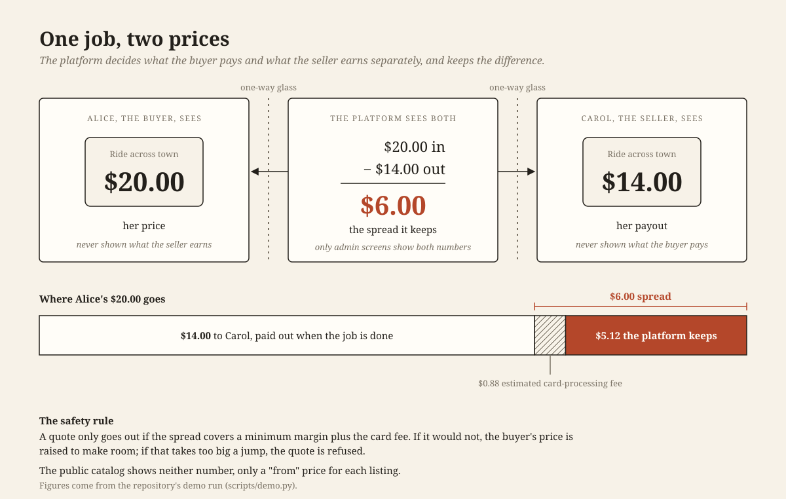
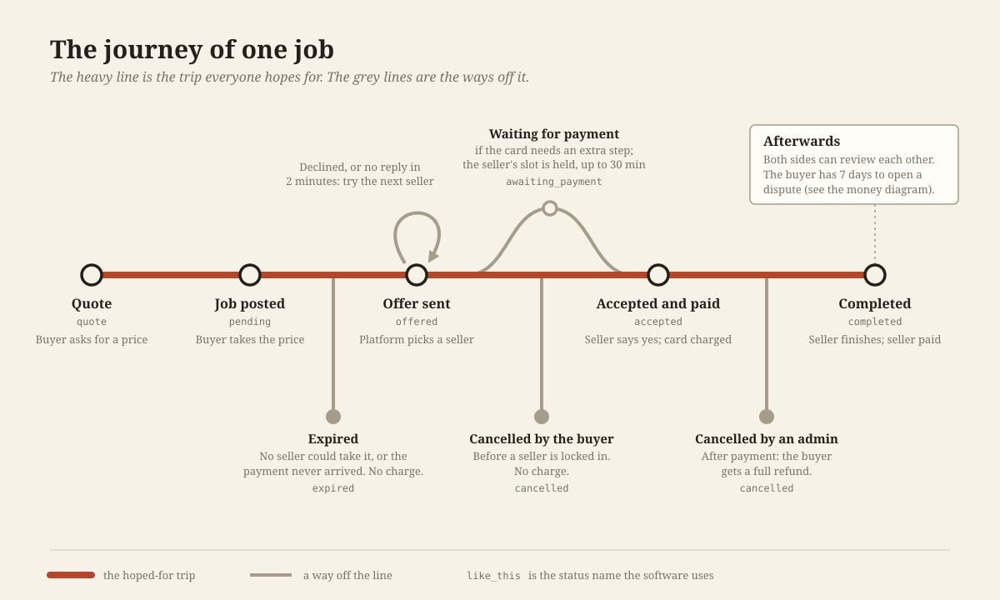
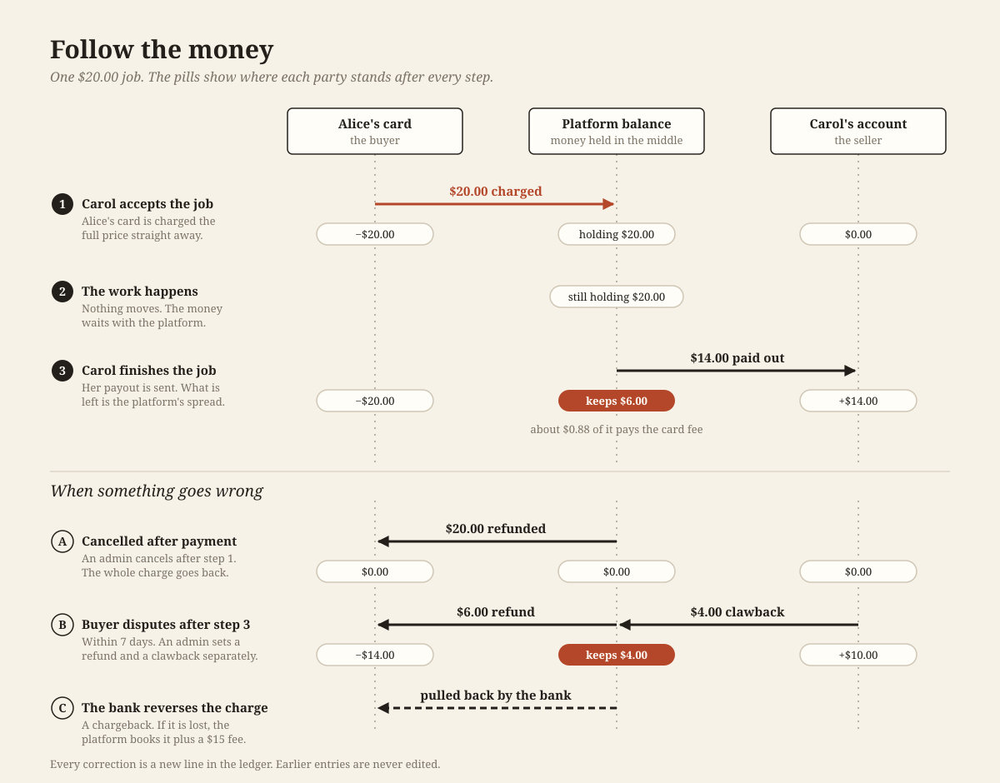
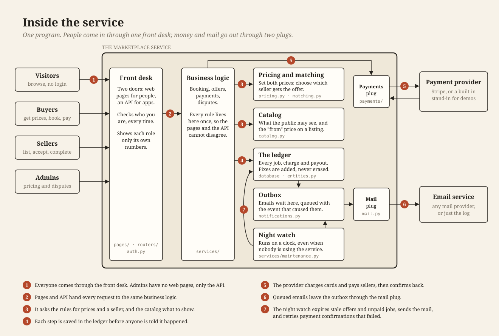

# Diagrams

Four pictures for people who need to understand the marketplace without
reading the code. Read them in order; each is a standalone SVG.

Every dollar figure comes from the demo run (`uv run python scripts/demo.py`):
a $20.00 job, a $14.00 payout, a $6.00 spread.

## 1. One job, two prices

The business model. The buyer and the seller each see only their own number;
the platform sees both and keeps the difference.

## 2. The journey of one job

Every state a job can be in, drawn as a route map: the trip everyone hopes
for, and the ways a job can leave it.

## 3. Follow the money

Who holds the money after each step, and how it moves back when a job is
cancelled, disputed or charged back.

## 4. Inside the service

The parts of the program and what each one is for, with the file names for
anyone who wants to go and look.

